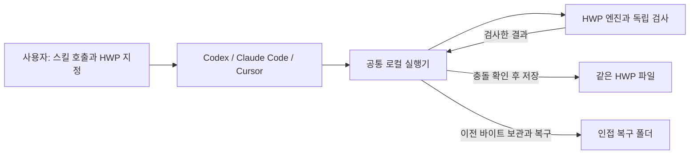
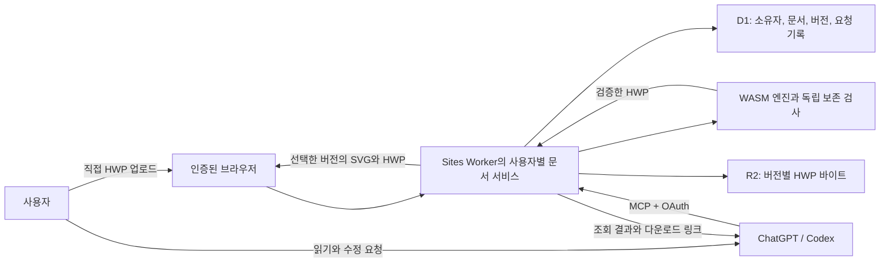

# 아키텍처

[프로젝트 개요](../README.md) · [문서 인덱스](README.md) · [개발 가이드](developer-guide.md)

HWP Easy는 공통 HWP 엔진과 로컬 실행기를 여러 에이전트 클라이언트에 배포합니다. 엔진은 문서를 읽고 수정본을 만들며, 로컬 실행기는 대상과 보존 조건을 검사해 같은 파일에 저장합니다. 앱마다 엔진을 따로 유지하지 않습니다.

## 메인 로컬 파일 흐름

메인 소스·검증 패키지는 **0.2.21**, Codex 설치는 **0.2.20**, Claude Code·Cursor 실제 설치와 공개 ZIP은 **0.2.19**입니다. 같은 버전의 앱별 패키지는 공통 Node 실행기와 WASM을 포함합니다. HWP Easy 서버나 OAuth 연결이 필요하지 않습니다.

배포본의 차이는 앱에 맞춘 호출 이름·명시적 호출 설정·패키지 구성입니다. 같은 버전의 공통 빌드 결과를 복사하므로 해당 버전의 실행기와 WASM 해시도 같습니다. 사용자는 설치한 스킬을 선택하거나 `/hwp-easy`로 호출합니다. [앱별 설치와 호출](agent-client-skills.md)

## 계층별 책임

| 계층 | 구현 | 책임 |
| --- | --- | --- |
| HWP 엔진 | `@rhwp/core` 0.8.6 | HWP 모델 읽기·텍스트 변경·HWP 쓰기·SVG 생성 |
| 공통 어댑터 | `src/one_hwp/*.mjs` | 엔진 처리, 대상·스타일·글꼴 비교 |
| 독립 검사 | `probes/sites-runtime/guard/` | CFB·레코드·대상 매핑·비대상 바이트·변경 조건 확인 |
| 로컬 실행기 | `src/one_hwp/local_runner.mjs`, `local_*.mjs` | 읽기·계획·편집·이력·복구 명령 |
| 복잡한 개체 편집 | `local_complex_picture.mjs`, `local_complex_table.mjs`, `local_complex_field.mjs`, `local_complex_group.mjs` | 검증된 대상의 raw 기록만 변경하고 나머지 개체를 보존하는 경로. 0.2.21은 병합 중첩 표·셀 경계·배치·개체 셀 삭제를 확장 |
| 로컬 파일 저장 | `src/one_hwp/local_file.mjs` | 충돌 검사·이전 바이트 보관·같은 경로 저장 |
| 내장 미리보기 | `local_preview_cache.mjs`, resvg WASM·폰트 | 검증된 저장 후보의 UTF-16 텍스트·BMP 갱신, 실패 시 오래된 이미지 제거 |
| 로컬 컨테이너 쓰기 | `local_container_write.mjs` | 재배치 후 비대상 압축 스트림의 정확한 보존 |
| 공통 배포 소스 | `plugins/hwp-easy/` | 핵심 스킬 지침·참조·명시적 호출 정책 |
| 패키지 생성 | `scripts/package_local_plugin.mjs`, `package_agent_skills.mjs` | 한 번 만든 실행기로 Codex·Claude Code·Cursor 배포본 생성 |

독립 검사와 일부 빌드 도구는 원격 실험 때 정한 `probes/sites-runtime/` 경로를 재사용합니다. 이 코드를 로컬 번들에 포함하는 것이 원격 서버 연결을 뜻하지는 않습니다. 수정할 소스와 빌드 명령은 [개발 안내](developer-guide.md)에 정리했습니다.

## 로컬 저장과 복구

1. 접근 가능한 HWP의 현재 해시와 대상·기존 내용을 확인합니다.
2. 요청한 수정 전체를 계획하고 지원 조건을 검사합니다.
3. 수정본을 생성하고 재열기·비대상 보존 검사를 수행한 뒤 내장 미리보기 캐시를 갱신합니다.
4. 현재 파일이 바뀌지 않았는지 확인한 뒤 이전 바이트를 보관하고 같은 경로에 저장합니다.

한 작업이라도 실패하면 일부만 저장하지 않습니다. 실제 변화가 없으면 새 저장과 백업을 만들지 않습니다. 복구할 때도 현재 편집본을 보관하므로 다시 복구할 수 있습니다. [사용자 저장·복구 안내](quick-start.md)

파일 접근은 에이전트 실행 환경의 권한을 따릅니다. 첨부 사본·WSL·Cloud의 파일과 PC 원본은 자동 동기화되지 않습니다. 새 Cloud 작업의 로컬 메인 전체 흐름은 아직 별도 검증 대상입니다. [현재 검증 상태](project-status.md)

## 구현과 증거의 경계

패키지 생성, 설치된 실행기의 검사, 앱의 실제 스킬 호출, 외부 HWP 프로그램의 화면 비교는 각각 별도로 확인합니다. 내용·구조·바이트 검사를 통과해도 외부 뷰어의 모든 글꼴과 쪽 배치를 보장하지는 않습니다. [지원 기능과 미리보기 제한](supported-features.md)

메인과 별도로 원격 0.1.9, 이전 Python stdio MCP와 Windows COM을 보관합니다. 메인 엔진이 거부됐을 때 이 경로로 자동 전환하지 않습니다. Dots와 HWPX·PDF·DOCX 변환은 현재 제품 범위에 포함하지 않습니다.

## 원격 문서 흐름

**아래는 보관한 원격 0.1.9의 구조입니다.** 로컬 메인의 설치 조건이나 저장 방식으로 적용하지 않습니다.

브라우저와 MCP는 같은 계정의 서버 사본을 사용하며, 채팅 첨부는 서버로 자동 전달되지 않습니다. 링크로 파일을 가져올 때는 별도로 허용한 HTTPS origin만 사용합니다.

| 원격 계층 | `probes/sites-runtime/` 아래 경로 | 책임 |
| --- | --- | --- |
| 원격 엔진 계약 | `engine/` | 전체·부분 읽기, 편집 제한, 사전 계획, 작업량 검사 |
| 원격 서비스 | `host/`, `worker/` | MCP·브라우저 요청, 파일 전송, 사용자 신원 적용 |
| 지속 저장 | `storage/`, `db/`, `drizzle/` | 버전 보관, 충돌·중복 검사, 복구·삭제 |

보관 패키지는 `plugins/archive/hwp-easy-remote-0.1.9/`에 있습니다. [원격 문서 계약](remote-documents.md), [원격 저장 계약](durable-storage.md)에 기록합니다.

## 저장과 권한

이 절은 **원격 서비스의 권한·저장 계약**입니다. Sites의 신뢰 경계 안에서 제공하는 사용자 ID·이메일 헤더를 확인하고, 사용자 ID에서 사이트별 소유자 키를 생성합니다. 헤더 존재 검사는 독립 OAuth 검증기가 아니므로 별도 호스팅에서 외부 요청의 신원 헤더를 그대로 신뢰하면 안 됩니다. 서비스 접근 자격도 사용자 문서 권한으로 취급하지 않습니다.

해당 사용자의 문서·버전만 조회하고 편집 전 기존 내용·해시·현재 버전·요청 ID를 확인합니다. 수정본 재열기와 보존 검사 뒤 새 버전으로 저장하며, 묶음 중 한 작업이 실패하면 일부만 저장하지 않습니다. 복구도 새 버전을 만듭니다. 서버 저장은 PC 원본을 바꾸지 않습니다.

원격 문서는 사용자가 명시적으로 삭제할 때까지 보관하며 연결 해제와 삭제는 별개입니다. 실제 계정의 원격 처리와 모의 신원 헤더의 격리 검사는 구분합니다. 다른 실제 OAuth 계정의 문서 격리는 아직 검증하지 않았습니다.

이전 Python 연결은 `src/one_hwp/native_*.py`와 [개발 기록](native-engine.md), Windows COM의 `one-hwp`·`one-hwp-mcp`는 [이전 문서](legacy/README.md)에 보관합니다.
