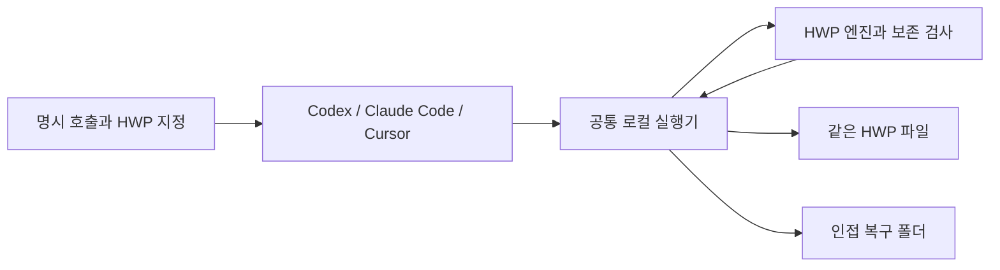

# 아키텍처

[문서](README.md) | [개발 가이드](developer-guide.md) | [제품 범위](PRD.md)

HWP Easy는 공통 로컬 실행기와 HWP 엔진을 세 에이전트 앱에 배포합니다. 앱마다 엔진을 분기하지 않습니다.

## 실행과 저장

실행기는 현재 파일 해시와 수정 대상 및 기대값을 확인합니다. 편집 후보를 만들고 다시 열어 비대상 보존을 검사한 뒤, 현재 파일이 바뀌지 않았는지 확인해 같은 경로에 저장합니다. 이전 바이트는 `.hwp-easy-backups`에 보관합니다.

여러 수정은 전체 검사를 통과한 뒤 한 번 저장합니다. 중간에 실패하면 일부만 저장하지 않으며 실제 변화가 없으면 저장과 백업을 만들지 않습니다. 복구 역시 현재 파일을 확인하고 복구 직전 편집본을 보관합니다.

## 구성

| 계층 | 소스와 역할 |
| --- | --- |
| HWP 엔진 | `@rhwp/core` 0.8.6. HWP 모델과 읽기 및 쓰기 |
| 로컬 실행기 | `src/one_hwp/local_runner.mjs`, `local_*.mjs`. 읽기, 계획, 편집과 복구 |
| 독립 보존 검사 | `probes/sites-runtime/guard/`. 컨테이너와 원시 레코드 및 비대상 비교 |
| 표와 개체 편집 | `local_complex_*.mjs`, `local_object_*.mjs`, `local_reflow.mjs`와 관련 모듈 |
| 미리보기 | `local_render_view.mjs`와 관련 뷰. 원본과 분리된 표시 보정 |
| 파일 저장 | `local_file.mjs`. 충돌 검사, 이전 바이트 보관과 같은 파일 저장 |
| 공통 지침 | `plugins/hwp-easy/skills/edit-local-hwp/`. 스킬과 요청 계약 |
| 설치 도우미 | `packages/hwp-easy/`. 앱 선택, 검증 설치와 업데이트 및 복귀 |

`probes/sites-runtime/guard`와 일부 빌드 도구는 이전 원격 실험의 경로를 재사용하는 공통 코드입니다. 현재 로컬 실행과 검사에도 필요합니다. 이 경로를 번들에 포함하는 것이 서버 연결을 뜻하지 않습니다.

## 미리보기의 경계

보정 뷰는 원본 글꼴 지표와 표 및 개체 경로를 대조해 일회용 입력을 구성합니다. 생성한 표시용 줄바꿈과 문단, 정규화한 텍스트와 큰 측정용 쪽은 저장하지 않습니다. 뷰는 저장과 내보내기 API를 제공하지 않으며 표시 결과를 원래 대상에 연결합니다.

명시적 SVG 미리보기와 저장 썸네일 및 배치 진단은 같은 표시 뷰를 사용합니다. 신원을 확인하지 못한 개체나 범위 밖 구조는 보정하지 않고 이유를 남깁니다. [지원 조건](reference/support.md)

## 배포와 설치

`main`은 소스, `distribution`은 검증한 배포본입니다. npm은 공통 엔진을 한 번 포함하고 선택한 앱에 맞게 설치합니다. Codex는 등록 정보와 아이콘 및 스킬을 가진 로컬 플러그인, Claude Code와 Cursor는 사용자 스킬 폴더에 설치하는 개인 스킬입니다. 실제 실행기와 WASM은 같습니다.

설치된 사본은 독립적이며 한 앱의 업데이트가 다른 앱을 바꾸지 않습니다. 이전 설치는 발견 경로 밖에 보관합니다. 설치 버전 복귀와 HWP 문서 복구는 별개의 작업입니다. [설치와 업데이트](distribution.md)

이전 원격 서버와 Python MCP 및 Windows COM은 [보관 자료](archive/README.md)에 분리합니다. 현재 제품의 기본 실행이나 자동 실패 대체 경로로 사용하지 않습니다.
