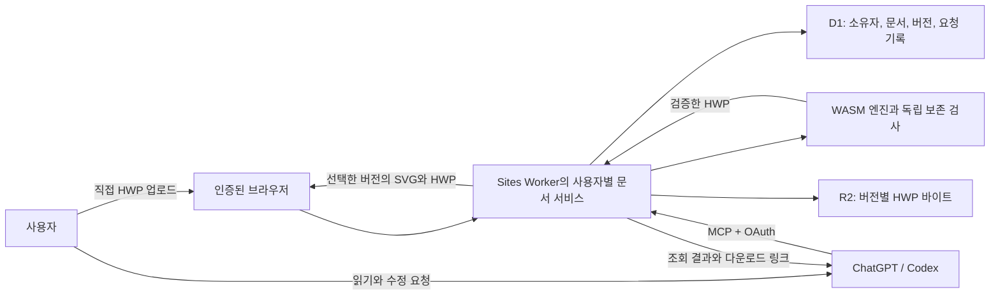

# 구조 설명

HWP Easy는 WASM 엔진으로 HWP를 처리하고, 에이전트가 선택한 대상만 수정하도록 검사합니다. 엔진 코드는 공통으로 사용하며 파일 접근과 저장은 로컬 실행기와 원격 Worker가 각각 맡습니다.

## 메인 로컬 파일 흐름

2026년 10월 12일부터 로컬 실행 방식이 HWP Easy 메인입니다. 현재 0.2.18은 Codex와 Claude Code·Cursor용으로 같은 Node 실행 코드와 WASM을 포함하며 HWP Easy 서버나 OAuth 연결을 요구하지 않습니다.

PC 또는 Cloud 실행 환경의 파일 권한을 따릅니다. Cloud와 첨부 사본은 PC 원본과 자동 동기화하지 않습니다. `local_runner.mjs`가 읽기·계획·편집·이력·복구를 제공하고 `local_file.mjs`가 충돌 검사, 복구 사본과 같은 경로 저장을 담당합니다. 원격 0.1.9는 별도 보관 경로입니다.

Codex 플러그인과 Claude Code·Cursor 개인 스킬은 공통 소스·빌드에서 생성합니다. 후자의 호출은 `/hwp-easy`이며 자동 호출을 금지합니다. 개인 스킬 설치는 서버나 호스트 설정을 등록하지 않습니다. [클라이언트 배포 구조와 검증](agent-client-skills.md)

## 원격 문서 흐름

브라우저와 MCP는 같은 계정의 원격 문서를 사용합니다. 채팅 첨부는 서버로 자동 전달되지 않습니다. 링크로 파일을 가져올 때는 별도로 허용한 HTTPS origin만 사용합니다.

## 계층별 책임

| 계층 | 구현 | 책임 |
| --- | --- | --- |
| 문서 엔진 | `@rhwp/core` 0.8.6 | HWP 모델 읽기, 텍스트 변경, HWP 쓰기, SVG 생성 |
| 공통 어댑터 | `src/one_hwp/*.mjs` | Node와 Worker가 재사용하는 엔진 처리, 스타일, 글꼴 비교 |
| 독립 검사 | `probes/sites-runtime/guard/` | CFB, 레코드, 대상 매핑, 비대상 바이트와 변경 조건 확인 |
| 원격 엔진 계약 | `probes/sites-runtime/engine/` | 전체/부분 읽기, 대상별 편집 제한, 사전 계획, 입력 작업량 검사 |
| 원격 서비스 | `host/`, `worker/` | MCP와 브라우저 라우팅, 입력 검증, 파일 전송, 사용자 신원 적용 |
| 지속 저장 | `storage/`, `db/`, `drizzle/` | 버전 보관, 충돌 검사, 중복 저장 방지, 복구와 삭제 |
| 메인 로컬 실행기 | `src/one_hwp/local_*.mjs` | 직접 파일 읽기와 편집, 검증된 같은 파일 저장·이력·복구 |
| 이전 Python 연결 | `src/one_hwp/native_*.py` | 좁은 지원 범위의 로컬 MCP와 저장 |
| 메인 배포 패키지 | `plugins/hwp-easy/` | 명시적으로 선택하는 스킬과 번들 실행기의 소스 |
| 보관한 원격 패키지 | `plugins/archive/hwp-easy-remote-0.1.9/` | 기존 HTTPS MCP·OAuth 제출 패키지 |

표에서 `host/`, `worker/`, `storage/` 등의 원격 경로는 모두 `probes/sites-runtime/` 아래입니다. 이 디렉터리는 실험 때 정한 이름을 유지하지만 현재 비공개 운영 Worker의 개발 소스도 포함합니다. 변경 위치는 [개발 시작](developer-guide.md)을 따릅니다.

## 저장과 권한

Sites가 신뢰 경계 안에서 제공하는 사용자 ID, 이메일 헤더를 확인하고, 사용자 ID에서 사이트별 소유자 키를 생성합니다. 헤더 존재 검사는 독립 OAuth 검증기가 아닙니다. 이 Worker를 별도 호스팅에 그대로 노출하거나 외부 요청의 신원 헤더를 신뢰하면 안 됩니다. 서비스 접근 자격도 사용자 문서 권한으로 취급하지 않습니다.

조회는 해당 사용자의 선택한 문서와 버전만 읽습니다. 편집할 때는 기존 내용과 해시, 현재 버전, 요청 ID를 확인합니다. 수정본을 생성하고 다시 열어 보존 검사를 통과하면 새 버전으로 저장합니다.

한 작업이라도 실패하면 묶음의 일부만 저장하지 않습니다. 이전 버전은 유지하고 복구할 때도 새 버전을 만듭니다. 원격 저장은 PC 원본을 바꾸지 않습니다.

문서는 사용자가 명시적으로 삭제할 때까지 보관합니다. 연결 해제와 문서 삭제는 별개입니다. [지속 저장 계약](durable-storage.md)과 [원격 문서 계약](remote-documents.md)에 실패, 재시도, 삭제의 자세한 조건을 기록합니다.

## 구현과 증거의 경계

실제 계정으로 확인한 원격 문서 처리와 모의 신원 헤더를 사용한 로컬 격리 검사는 따로 기록합니다. 다른 실제 OAuth 계정의 문서 격리는 아직 검증하지 않았습니다. 내용과 구조, 바이트 검사만으로 외부 뷰어의 모든 배치가 같다고 보장할 수는 없습니다.

`one-hwp`, `one-hwp-mcp`는 보존된 Windows COM 경로입니다. 새 엔진이 거부됐을 때 자동 실행하지 않습니다. [이전 문서](legacy/README.md)는 이 경로에만 적용합니다. Dots와 형식 변환은 현재 MVP 범위에 포함하지 않습니다.
